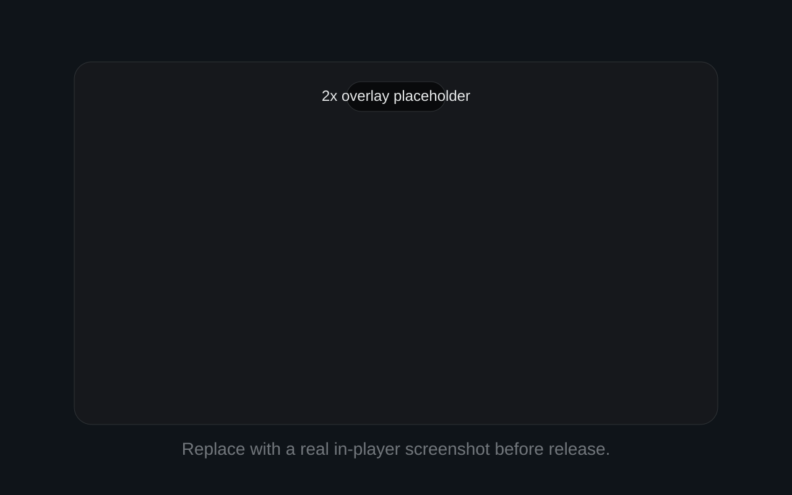
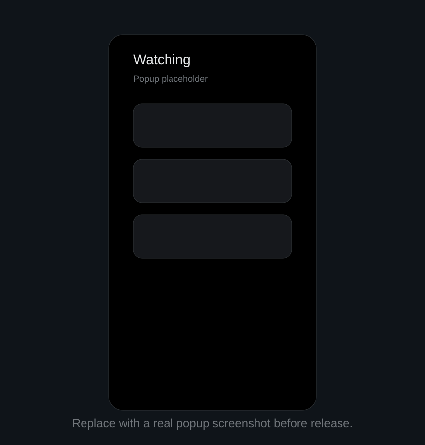

# betterXplayer

Minimal long-video playback tools for X.

## Features

| Feature | Details |
| --- | --- |
| Hold for `2x` | Press and hold on the video surface for about `180ms`, then release to return to the previous speed. |
| Resume unfinished videos | Keeps unfinished long videos in a compact popup and restores progress after a real watch session. |
| Long videos only | Ignores clips shorter than `60s` so GIF-style media and short posts do not pollute the list. |
| Local-only storage | Uses extension storage only. No external servers, analytics, or trackers. |

## Package

- Chrome package: `dist/betterXplayer-chrome.zip`
- Firefox package: `dist/betterXplayer-firefox.xpi`
- Build both with `powershell -ExecutionPolicy Bypass -File .\\scripts\\package.ps1`

## Load Locally

### Chrome

1. Open `chrome://extensions`
2. Enable `Developer mode`
3. Click `Load unpacked`
4. Select this folder

### Firefox / Zen

1. Open `about:debugging#/runtime/this-firefox`
2. Click `Load Temporary Add-on`
3. Select `manifest.json` from this folder, or load `dist/betterXplayer-firefox.xpi`

## Notes

- The extension uses one shared WebExtension codebase for Chrome and Firefox.
- Progress stays visible in the popup immediately, but resume starts only after meaningful watch time.
- Files for submission and reviewer notes are in [docs/store-listing.md](./docs/store-listing.md) and [docs/reviewer-notes.md](./docs/reviewer-notes.md).
- Official submission references are collected in [docs/publishing-checklist.md](./docs/publishing-checklist.md).
- Privacy details are in [PRIVACY.md](./PRIVACY.md).
