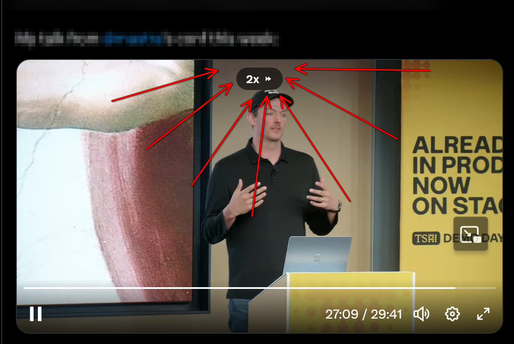
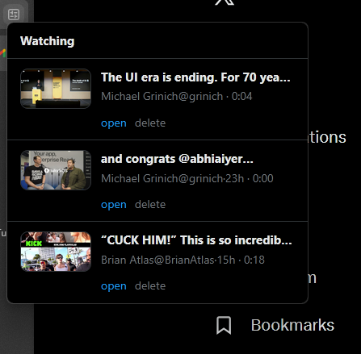

# betterXplayer

Hold X videos for temporary `2x` playback and keep unfinished long videos easy to resume.

[Demo video](./docs/assets/demo.mp4)

## Includes

- Hold for `2x`
- Resume unfinished long videos
- Ignore clips under `60s`
- Store progress locally only

## Packages

- Chrome: `dist/betterXplayer-chrome.zip`
- Firefox: `dist/betterXplayer-firefox.xpi`
- Build: `powershell -ExecutionPolicy Bypass -File .\\scripts\\package.ps1`
