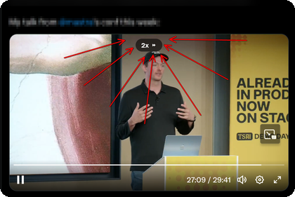
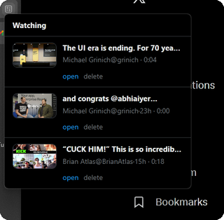

  <h1>betterXplayer</h1>
  
Hold X videos for temporary <code>2x</code> playback and keep unfinished long videos easy to resume.

  

    
  

  

    
  

  

    
  

  
Hold for <code>2x</code> · Resume unfinished long videos · Ignore clips under <code>60s</code> · Local-only storage

  

    Chrome: <code>dist/betterXplayer-chrome.zip</code> 
    Firefox: <code>dist/betterXplayer-firefox.xpi</code> 
    Build: <code>powershell -ExecutionPolicy Bypass -File .\scripts\package.ps1</code>
  

