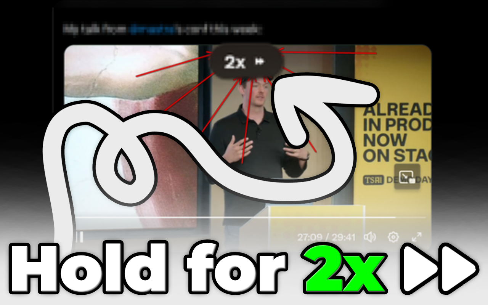
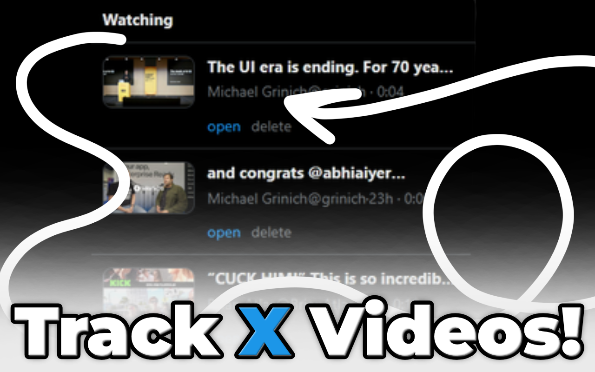
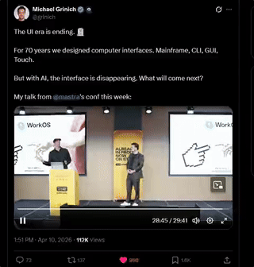

<h1 align="center">betterXplayer</h1>

A lightweight X video helper for hold-to-2x playback and unfinished long-video resume.

  
  

  
  
  

## Features

<table>
<tr>
<td width="40%" valign="middle">
<h3>Hold for 2x</h3>
Press and hold on the video surface for about 180ms to jump to <code>2x</code>, then release to return to the previous speed.
</td>
<td width="60%">

</td>
</tr>
<tr>
<td width="40%" valign="middle">
<h3>Resume unfinished videos</h3>
Keep unfinished videos in a compact popup so you can reopen them later without digging through likes, bookmarks, or tabs.
</td>
<td width="60%">

</td>
</tr>
<tr>
<td width="40%" valign="middle">
<h3>In action</h3>
A quick look at the extension running on X.
</td>
<td width="60%">

</td>
</tr>
</table>

<h2 align="center">Notes</h2>

Tracks only videos longer than <code>60s</code>

Stores progress locally with the browser extension storage API

Supports Chrome and Firefox from one shared WebExtension codebase

Keeps the UI intentionally close to X instead of adding a custom dashboard

<h2 align="center">Packages</h2>

Chrome: <code>dist/betterXplayer-chrome.zip</code>

Firefox: <code>dist/betterXplayer-firefox.xpi</code>

Build: <code>powershell -ExecutionPolicy Bypass -File .\scripts\package.ps1</code>

  <a href="https://star-history.com/#jasperdevs/better-x-player&Date">
    <picture>
      <source media="(prefers-color-scheme: dark)" srcset="https://api.star-history.com/svg?repos=jasperdevs/better-x-player&type=Date&theme=dark" />
      <source media="(prefers-color-scheme: light)" srcset="https://api.star-history.com/svg?repos=jasperdevs/better-x-player&type=Date" />
      
    </picture>
  </a>

<h2 align="center">License</h2>

betterXplayer is available under the <a href="./LICENSE">MIT License</a>.

